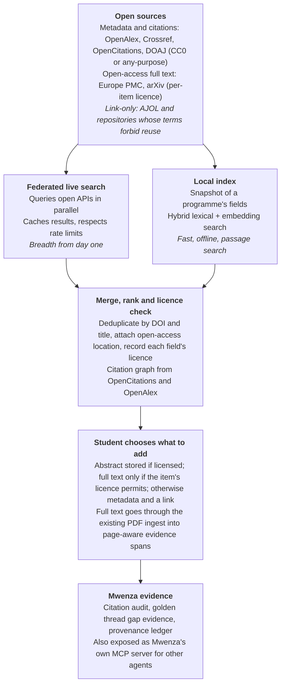
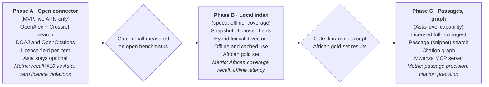

# Mwenza Scholarly Discovery Engine: Design Analysis

17 October 2026 · Cecil Ouma

> Generated from the prompt in [`docs/prompts/DISCOVERY_ENGINE_PROMPT.md`](../prompts/DISCOVERY_ENGINE_PROMPT.md). Live, commentable version: [Claude Doc](https://claude.ai/code/artifact/491fc9bb-3585-4b35-8c20-d9c718e73508).

## Summary

Mwenza can match Asta's four capabilities (paper search, passage search, citation graph, author lookup) using only openly licensed data. The backbone is **OpenAlex** (CC0 metadata), **OpenCitations** (CC0 citations) and **Crossref** (metadata usable "for any purpose"). Passage search runs only over open-access full text whose licence permits reuse, chiefly from **Europe PMC** and **arXiv**.

- **Why not copy Asta:** Asta is built on Semantic Scholar. Both Asta's licence and Semantic Scholar's API terms forbid reverse engineering and redistribution, and much Semantic Scholar data carries non-commercial licences. A clean-room design keeps Mwenza licensable.
- **Recommended design:** a hybrid. Live federated search across open APIs gives breadth from day one. A local index of the sources a programme actually uses gives speed, offline use and passage search.
- **Mwenza's edge:** licence-aware ingestion that records each item's licence, African coverage that global tools neglect (AJOL, DOAJ, institutional repositories), and results that flow straight into the citation audit, golden thread and provenance ledger.
- **The hard part:** passage search. Open full text is a fraction of the literature, and each article's licence must be checked before its text is stored.
- **Cost:** a small deployment runs on one modest server using live APIs. University scale needs a local index and storage, still well below commercial database subscriptions. Figures in the cost section are estimates.

## Where Asta gets its data

Asta's corpus tool is an MCP layer over the Semantic Scholar API, so its data is Semantic Scholar's data. That data comes from a mix of open sources and private publisher agreements, which is why Mwenza cannot simply rebuild it.

| Layer | What Semantic Scholar uses | Can Mwenza use the same? |
| --- | --- | --- |
| Paper metadata | 50+ input sources: Crossref, preprint servers such as arXiv, publishers under negotiated agreements, its own web crawler, plus author claims and manual corrections | The open parts, yes (Crossref, arXiv). The publisher agreements and crawl are Semantic Scholar's own. |
| Publisher content | "More than 50 direct partnerships" covering 500+ journals, presses and societies (for example Springer Nature, Wiley, Taylor & Francis, SAGE, IEEE, ACM) | No. These are private agreements. |
| Full text (S2ORC) | Extracted from PDFs into structured text; counts are reported for open-access papers | Only by doing the same with openly licensed full text |
| Abstracts | Included "where allowed by licensing" | Same rule applies to Mwenza |
| Scale | About 225M papers, 105M authors and 2.8B citation edges (May 2025) | OpenAlex is of a similar scale and CC0 |

The Semantic Scholar API licence forbids reselling, distributing or sublicensing the API and reverse engineering the service, and lets API keys be shared only with authorised users in your organisation. The data itself is governed by separate data licences, some non-commercial (CC BY-NC) and some ODC-By. Building Mwenza's commercial discovery on Semantic Scholar would therefore inherit the same limits as Asta.

The Semantic Scholar data-source details come from its [Open Data Platform paper](https://arxiv.org/html/2301.10140v2) and [publishers page](https://www.semanticscholar.org/about/publishers). The licence terms come from its [API licence](https://www.semanticscholar.org/product/api/license).

## Open data sources compared

Three sources can carry Mwenza's discovery commercially: OpenAlex, DOAJ and OpenCitations are CC0, and Crossref metadata is usable for any purpose. Full text is the constraint. African journals are best covered by AJOL, but AJOL forbids reusing its abstracts and full text, so Mwenza can only link to it. Items marked † were not confirmed on an official page.

| Source | What it gives | Licence and commercial use | Access | African relevance |
| --- | --- | --- | --- | --- |
| [OpenAlex](https://help.openalex.org/api-reference/authentication.md) | Works, authors, institutions, venues, citations, topics | "All data is CC0"; commercial use allowed | API (free key raises the daily budget 10×; heavier use is pay-as-you-go); free quarterly bulk snapshot | Broad, inherits Crossref and repository coverage |
| [Crossref](https://www.crossref.org/documentation/retrieve-metadata/rest-api/) | DOI metadata, references, some abstracts, licence URLs | Metadata usable "for any purpose"; some abstracts copyrighted by publishers | REST API, no sign-up; polite pool with an email | Any African journal that registers DOIs |
| [OpenCitations](https://opencitations.net/about) | Open citation links between DOIs | CC0 | API and dumps† | Follows DOI coverage |
| [DOAJ](https://doaj.org/terms/) | Open-access journal and article metadata, abstracts, full-text links | Metadata CC0; commercial use allowed | API (2 requests/second); [full public data dumps](https://doaj.org/docs/api/) | Lists many African OA journals |
| [Europe PMC](https://europepmc.org/downloads/openaccess) | Biomedical and life-science full text | Open-access subset under Creative Commons or similar, terms vary per article | REST and OAI web services; weekly full-text XML and monthly PDF via FTP | Strong for health research |
| [arXiv](https://info.arxiv.org/help/bulk_data.html) | Preprints, metadata and full text | Most papers use arXiv's non-exclusive licence, which grants no redistribution rights; tools built on full text must link back to arXiv | OAI-PMH metadata daily; full corpus via S3; API at about 4 requests per burst then 1 s pause | Limited |
| [AJOL](https://www.ajol.info/index.php/ajol/about) | African journals across 39 countries plus multi-country | Reuse of AJOL-hosted abstracts and full text "is not nor has ever been legally permitted" | Link out only; API or OAI-PMH not mentioned on its about page | The largest African journal platform |
| Unpaywall† | Open-access status and the best legal OA location per DOI, with licence | Believed CC0† | Free API with an email† | Finds legal OA copies of African papers |
| CORE† | Aggregated repository full text | Terms page not reachable; commercial use reportedly licensed separately† | API† | Includes some African repositories† |
| African institutional repositories | Theses, reports, articles (mostly DSpace or EPrints) | Varies per repository and item | OAI-PMH is typical† | Unique grey literature and theses |
| Semantic Scholar (for contrast) | 225M papers, citations, snippets | API licence bars redistribution; data partly CC BY-NC | Key-based API | Broad but not licensable for Mwenza |

Two rules follow from the table:

- **Full text is per item, never per source.** Even Europe PMC's open-access subset varies by article, so Mwenza must read each item's licence and store full text only when the licence allows it.
- **Respect AJOL.** Index AJOL titles only through open metadata (for example a journal's DOIs in Crossref or OpenAlex) and link to AJOL for reading.

## Architecture

A hybrid works best. Live federated search covers all open literature from the first release, while a local index adds speed, offline use and passage search for the fields a programme actually uses.

The licence check sits between search and storage, so nothing enters a notebook without a recorded licence. The same pipeline is exposed as Mwenza's own MCP server, with tools that mirror Asta's (paper search, title search, passage search, citations, author lookup), so other agents can use Mwenza's discovery under Mwenza's licence.

## How results enter Mwenza's evidence contract

Discovery results stay candidates until the student chooses them; only chosen items become notebook sources. This keeps abstention intact: Mwenza never answers from a search result the student has not seen.

1. **A normalised record per work.** Each result becomes one record keyed by DOI (or OpenAlex ID when there is no DOI), merged across sources. It carries title, authors, year, venue, abstract where licensed, open-access status, best legal open-access location, and the **licence of every field it stores**.
2. **Licence-gated text.** When a student adds a work, Mwenza stores the abstract only if its licence allows. It stores full text only if the item's own licence allows reuse; Creative Commons licences such as CC BY qualify, and arXiv's default licence and AJOL content do not. Otherwise the source holds metadata plus a link, and the page says so.
3. **Page-aware evidence.** Stored full text goes through the existing PDF ingest, so every passage is an `EvidenceSpan` with page and offsets. Passage-search hits are the same spans, so a cited snippet always points to inspectable text.
4. **Citation audit.** Added works carry a citation header (authors, year, title), so author–year citations match automatically, as Asta-imported items already do. A citation to a metadata-only source is marked "not checkable: full text not licensed" instead of being guessed.
5. **Golden thread gap evidence.** Gap checks can run passage search across the student's selected sources and, optionally, the local index, returning candidate passages for review, never a verdict.
6. **Provenance ledger.** Each search, and each item added, is recorded with its query, source APIs and retrieval date. The AI-use declaration can then state which literature tools were used.

## Evaluation plan

"As robust as Asta" should be a number. Mwenza can measure it on open benchmarks plus one African-coverage set built locally, with Asta, where its licence allows academic benchmarking, as the comparison baseline.

| Metric | What it measures | How |
| --- | --- | --- |
| Recall@10 and recall@50 | Paper search finds the papers that matter | Literature-search tasks from [AstaBench](https://allenai.org/blog/asta) (open source) and gold reference lists from published systematic reviews |
| Passage precision | Snippet hits actually answer the query | Expert-judged samples; [ScholarQABench](https://huggingface.co/papers/2411.14199), released with OpenScholar |
| Citation precision | A cited passage supports the claim | The existing Claim–Citation Auditor run over generated syntheses |
| African coverage | African-authored and African-journal work is found | A gold set of 200 to 500 papers from African journals and repositories in AIMS's fields, compiled by librarians; report recall against it |
| Licence compliance | No full text is stored without a permitting licence | An automated audit of every stored item's licence field; the target is zero violations |
| Latency and offline use | Usable on slow connections | Median search time on a throttled link, and the share of queries answered from the local index |

The African-coverage set matters most. It is the test no global tool is held to, and it shows whether Mwenza delivers on its stated focus. These metrics join `docs/EVALUATION.md` beside the existing citation and golden thread baselines.

## Cost estimate

The data is free; the cost is servers. These are rough planning ranges from typical cloud prices, not quotes. They assume open-source software throughout and should be re-priced with AIMS's own hosting provider.

| Item | Small deployment (one programme, live APIs) | University-wide (local index) |
| --- | --- | --- |
| Data | Free (OpenAlex free key, Crossref, DOAJ, OpenCitations, Europe PMC); OpenAlex charges beyond its free daily budget | Free quarterly OpenAlex snapshot plus open dumps; optional paid OpenAlex plan for monthly snapshots or daily changes |
| Server | One VM, about 4 vCPU and 16 GB RAM | Two or three VMs, about 8 to 16 vCPU and 64 GB RAM for search |
| Storage | Tens of GB (cache plus added sources) | 1 to 2 TB for metadata, abstracts and selected open-access full text |
| Embeddings | Computed on demand for added sources (CPU is enough) | One-off batch over the index (a rented GPU for days, not months), then incremental |
| Rough monthly range | About US$40 to US$100 | About US$300 to US$900 |

Two levers keep costs down: index only the fields a programme works in rather than all 200M+ works, and keep full text only for open-access items that are actually used. Neither changes what students can search, because live federated search still covers everything else.

## Phased build plan

Phase A replaces Asta's role with open sources behind the existing Find literature page, so students see no change except the licence label on each result. Each later phase starts only after its gate is met.

- **Phase A** reuses the MCP-client pattern and page already built. It adds a source-adapter interface so each open API is one small module with its own licence and rate-limit record in the capability registry.
- **Phase B** needs one decision from AIMS: which fields to index first. The African gold set should be compiled with AIMS librarians at the same time.
- **Phase C** is where Mwenza matches Asta's passage search. It is also where licence handling matters most, because full text is stored.

## Sources

Official pages opened for this analysis:

- [The Semantic Scholar Open Data Platform (paper)](https://arxiv.org/html/2301.10140v2) · [Semantic Scholar publishers](https://www.semanticscholar.org/about/publishers) · [Semantic Scholar API licence](https://www.semanticscholar.org/product/api/license)
- [Asta MCP tools](https://allenai.org/asta/resources/mcp) · [Asta corpus licence](https://allenai.org/asta-corpus-license) · [Asta announcement](https://allenai.org/blog/asta)
- [OpenAlex authentication and licence](https://help.openalex.org/api-reference/authentication.md)
- [Crossref REST API](https://www.crossref.org/documentation/retrieve-metadata/rest-api/)
- [OpenCitations about](https://opencitations.net/about)
- [DOAJ terms](https://doaj.org/terms/) · [DOAJ API](https://doaj.org/docs/api/)
- [Europe PMC open-access subset](https://europepmc.org/downloads/openaccess)
- [arXiv bulk data](https://info.arxiv.org/help/bulk_data.html)
- [AJOL about](https://www.ajol.info/index.php/ajol/about)
- [OpenScholar paper, with ScholarQABench](https://huggingface.co/papers/2411.14199)

**Not verified on an official page:** OpenAlex's exact free daily budget and prices, and its free quarterly snapshot (seen only in search summaries); Unpaywall's terms and limits; CORE's terms (its page refused access); Europe PMC's API rate limits (its page refused access); OpenCitations' API and dump details; AJOL's API availability. All costs are planning estimates.
