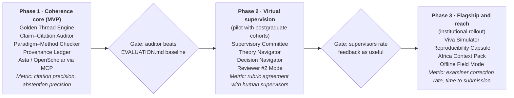

# Mwenza Competitive Landscape & Methodology Engine Analysis

17 October 2026 · Cecil Ouma

> Generated from the prompt in [`docs/prompts/LANDSCAPE_ANALYSIS_PROMPT.md`](../prompts/LANDSCAPE_ANALYSIS_PROMPT.md). Live, commentable version: [Claude Doc](https://claude.ai/code/artifact/ae272544-a4e6-4e4a-aa0b-4757f2027f1d).

## Executive summary

Mwenza should not compete on search or summaries. Elicit, NotebookLM, Asta and OpenScholar already do those well. The opening is **methodological coherence**: no tool we found checks whether a student's problem statement, questions, theory, design and analysis actually fit together, or teaches them why.

- **Search and synthesis are commoditised.** OpenScholar (45M papers) and Asta (200M+ papers via MCP) are open source and free. Mwenza should plug into them rather than rebuild them.
- **Citation existence is mostly solved, citation faithfulness is not.** Retrieval-grounded systems no longer invent papers. But checking that a cited source *supports the specific claim* is still the weak spot, and writing tools like Jenni and Paperpal don't check it.
- **Writing tools sit on an integrity fault line.** Universities are tightening rules on AI drafting. A tool that coaches and audits, rather than writes, is safer to adopt institutionally.
- **The postgraduate layer is empty.** Nothing models a supervisor: paradigm → theory → design alignment, the golden thread, examiner-style critique, or African institutional norms.

**Strategic bet:** position Mwenza as an *AI research supervisor and examiner*. It keeps NotebookLM-style grounding and Notion-style organisation, and adds a methodology engine that reasons about research design, flags misalignment and shows its evidence. Mwenza's evidence contract, abstention and governed agents (Methodologist, Sceptic) are already the right base for this.

## Landscape scan

The field splits into five groups. None of them gives methodology guidance at postgraduate level. Items marked † come only from secondary or vendor-adjacent sources.

| Tool | Group | Core features | Grounding / citations | Methodology depth | Openness | Main weakness |
| --- | --- | --- | --- | --- | --- | --- |
| [NotebookLM](https://bibigpt.co/en/blog/posts/notebooklm-deep-research-vs-bibigpt-workflow-2026) | Source notebook | Chat over uploads; Audio, Video, Mind Map, Quiz, Slide outputs; Deep Research† | Inline citations to user sources | None | Proprietary | No research-design reasoning; outputs are summaries, not critique |
| [Notion AI 3.0](https://www.notion.com/blog/introducing-notion-3-0) | Workspace agent | Agents that build docs and databases, run multi-step tasks (up to 20 min), memory, MCP connectors | Workspace content only | None | Proprietary | General productivity tool; no scholarly grounding |
| [Elicit](https://paperguide.ai/blog/elicit-vs-consensus/) | Lit review | Screening, custom extraction columns, 138M+ papers† | Paper-level, extraction cells | Systematic-review workflow only | Proprietary | Stops at evidence tables; no theory or design help |
| [Consensus](https://paperguide.ai/blog/elicit-vs-consensus/) | Evidence lookup | Consensus meter, journal-quartile filters† | Paper-level | None | Proprietary | Yes/no framing flattens nuanced questions |
| [Undermind](https://theaiagentindex.com/agents/undermind) | Deep search | Agentic exhaustive search† | Paper-level | None | Proprietary | Discovery only |
| [SciSpace](https://ponder.ing/blog/scispace-alternatives) | Reading + writing | PDF explainer, multilingual† | Paper-level | Shallow | Proprietary | Weak multi-paper synthesis† |
| [Scite](https://manchester-uk.libanswers.com/teaching-and-learning/faq/270913) | Citation context | Smart Citations: supporting / contrasting / mentioning counts | Citation-statement level | None | Proprietary | Discovery aid, not draft verification |
| [Jenni AI](https://paperguide.ai/blog/jenni-vs-paperpal/) / [Paperpal](https://paperguide.ai/blog/jenni-vs-paperpal/) | Writing aid | Autocomplete drafting; polishing and submission checks | Inserted references, not claim-checked† | None | Proprietary | [Integrity concerns](https://sacra.com/c/jenni-ai); no check that sources support claims |
| [OpenScholar](https://huggingface.co/papers/2411.14199) | Open research LM | RAG over 45M open-access papers; 8B model | Passage-level; citation accuracy reported on par with experts | None | Fully open (code, model, datastore on HF) | Synthesis only; no pedagogy |
| [PaperQA2](https://arxiv.org/html/2409.13740v2) | Open research agent | Agentic QA, cited summaries; abstains ("insufficient information" 21.9% on LitQA2) | Passage-level | None | Open source | Science-QA focus; no writing guidance |
| [Ai2 Asta / Scholar QA](https://allenai.org/blog/asta) | Open agent ecosystem | Research assistant, AstaBench (2,400+ problems), MCP corpus tool over 200M+ papers | Passage-level | None | Agents and bench open; some UI closed | Infrastructure, not a supervisor |
| [STORM](https://arxiv.org/pdf/2604.03173) | Open report writer | Multi-perspective outline-then-write reports | Web citations | None | Open source | Wikipedia-style articles, not theses |
| [AI Scientist v2](https://www.danilchenko.dev/posts/2026-04-06-ai-scientist-v2-first-peer-reviewed-ai-paper/) / Agent Laboratory | Autonomous science | End-to-end ML experiments and papers; one ICLR 2025 workshop acceptance, later withdrawn | Generated | Automates rather than teaches | Open source | [Hallucinated results and overstated novelty](https://wandb.ai/byyoung3/ml-news/reports/Sakana-unveils-AI-Scientist-v2--VmlldzoxMjQxNTUzMw)†; replaces the student |
| [Claude for Life Sciences](https://www.anthropic.com/news/claude-for-life-sciences) | Vendor science stack | Connectors (PubMed, Benchling, Wiley Scholar Gateway, Synapse, 10x), Agent Skills, protocol drafting | Connector-grounded | Protocol drafting, domain-specific | Proprietary product; patterns are public | Biomedical focus; not a methodology tutor |
| HF Spaces ([Hugging Research](https://huggingface.co/spaces/daqc/hugging-research/blame/main/README.md), research-assistant forks) | Hobby / demo | smolagents agents, arXiv search, RAG demos | Varies | None | Open | Mostly 2023–24 forks, often unmaintained |

**Pattern:** every group optimises *finding* or *producing* text. None optimises *reasoning about research design*. That is the postgraduate gap.

## Comparison matrix

Methodology guidance, African context and low-bandwidth use are blank across the market. Mwenza today leads only on governance and abstention. Ratings are my judgement from the sources above: **S** = strong, **P** = partial, **–** = absent.

| Dimension | Mwenza now | Mwenza target | NotebookLM | Notion AI | Elicit | Scite | Jenni / Paperpal | OpenScholar / Asta | AI Scientist |
| --- | --- | --- | --- | --- | --- | --- | --- | --- | --- |
| Grounding in selected sources | S | S | S | P | P | P | – | S | – |
| Citation–claim verification | P | S | P | – | P | P | – | P | – |
| Abstention when evidence is missing | S | S | P | – | – | – | – | P | – |
| Methodology guidance | P (agent stub) | S | – | – | P (SR only) | – | – | – | – |
| Writing support (coaching, not ghost-writing) | – | S | P | P | – | – | P (drafts) | – | – |
| Knowledge organisation / collaboration | P | S | P | S | P | – | P | – | – |
| Multimodal outputs | P (cards) | S | S | P | – | – | – | – | P |
| Reproducibility / audit trail | S (run traces) | S | – | P | P | – | – | P | P |
| Academic-integrity safeguards | P | S | – | – | P | P | P | P | – |
| Offline / low-bandwidth | P (static browser app) | S | – | – | – | – | – | P (self-host) | – |
| African context (journals, ethics boards, languages) | P (stated focus) | S | – | – | – | – | – | – | – |

Mwenza's run traces and abstention are rare. Competitors treat these as features; Mwenza treats them as a contract. That is a credible base for the methodology layer.

## Gap analysis

We found eight gaps, and no tool covers more than one of them.

1. **Golden-thread alignment.** Nothing checks that the problem → gap → aim → questions → theory → design → analysis → findings chain holds together. Examiners often cite weak alignment as a reason for corrections (my judgement; not measured here).
2. **Theory versus framework literacy.** Tools summarise theories but don't help students choose one, justify it against alternatives, or turn constructs into variables or codes.
3. **Paradigm-to-method fit.** Nothing flags an interpretivist question answered with a survey, or a positivist hypothesis with no measurable construct.
4. **Claim-level citation faithfulness in the student's own draft.** Scite gives citation context for published papers. [No writing tool checks that the student's cited source supports the sentence](https://acurio.ch/en/blog/ai-thesis-writing-tools-compared.md).
5. **Supervisor and examiner simulation.** Students in African programmes report [limited supervisor access and slow feedback](https://www.scielo.org.za/pdf/sajhe/v39n1/15.pdf). Nobody offers rubric-based pre-examination critique.
6. **Integrity by design.** Writing tools generate prose. None shows provenance (who wrote what, AI or student) that a supervisor could inspect.
7. **Local context.** Nothing covers African journals (AJOL), national ethics bodies, institutional thesis templates, local-language sources, or [Global South supervision realities](https://digitalknowledge.cput.ac.za/handle/11189/9950).
8. **Low-bandwidth operation.** Every serious tool assumes always-on broadband and a cloud model.

Gaps 1–5 are the methodology moat. Gaps 6–8 are the adoption moat.

## Methodology engine spec

The engine treats a thesis as a **typed research-design graph**, not as prose. Each competency below is a node with rules, so Mwenza can guide, critique and check it, and every check cites evidence or abstains.

| Competency | Guide (teach) | Critique (examiner lens) | Verify (automated check) | Lead agent |
| --- | --- | --- | --- | --- |
| Problem statement and gap | Ideal → reality → consequence scaffold; gap types (evidence, knowledge, practical, theoretical, population, methodological) | Is the gap claimed or shown? Is it researchable? | Gap claim backed by ≥3 cited sources showing absence or conflict | Librarian + Sceptic |
| Aim, objectives, questions, hypotheses | SMART objectives; question–objective mapping; null and alternative hypotheses | Do the verbs match the design (explore vs test)? | Every RQ maps to one objective, one method and one analysis | Methodologist |
| Theoretical underpinning | Theory vs conceptual framework vs model; selection criteria; competing theories | Is the theory used or just decorative? | Each construct appears in the instruments and the analysis | Methodologist + Librarian |
| Conceptual framework | Variables or themes and relationships; diagram builder | Are the arrows justified by literature? | Each relationship cites a source | Synthesiser |
| Literature review | Systematic (PRISMA 2020), scoping (PRISMA-ScR), narrative, integrative; synthesis matrices | Description vs synthesis; recency; balance | Search string logged; PRISMA counts reconcile; claim–citation faithfulness | Librarian + Reproducer |
| Paradigm and philosophy | Ontology, epistemology, axiology; positivism, interpretivism, pragmatism, critical, Afrocentric and Ubuntu paradigms | Paradigm–method coherence | Paradigm tag consistent with design and data type | Methodologist |
| Design, sampling, instruments | Design catalogue; sample size and power; saturation; instrument adaptation | Threats to validity; sampling bias | Power calculation reproduced; constructs → items mapping | Methodologist + Reproducer |
| Validity, reliability, trustworthiness | Quantitative (Cronbach's α, CFA) vs qualitative (Lincoln & Guba) | Is the criterion matched to the paradigm? | Reported statistics recomputed where data exists | Reproducer |
| Analysis plan | Test selection by variable type; thematic, IPA, grounded theory; mixed-methods integration | Assumptions checked? | Analysis matches RQ and data level | Methodologist + Reproducer |
| Ethics | Consent, confidentiality, vulnerable groups, data protection, community engagement | Risk–benefit; local approval path | Ethics checklist complete; approval reference recorded | Sceptic |
| Limitations and delimitations | Distinguish scope choices from weaknesses | Are limitations hidden or inflated? | Each threat flagged earlier appears in limitations | Sceptic |
| Structure and writing | Thesis chapters, IMRaD, abstract formulas, hedging, academic voice | Argument flow; signposting | Section-to-RQ coverage; word-budget balance | Synthesiser |
| Publication | Journal fit, predatory-journal screening, cover letter, response-to-reviewers matrix | Contribution clarity; novelty claims | Journal indexed (DOAJ/Scopus/AJOL); every reviewer point answered | Scout + Sceptic |

**Teaching stance:** Mwenza asks Socratic questions first. It shows an annotated exemplar second. It never writes the student's argument for them. Every suggestion is tagged *teach*, *critique* or *check*, so supervisors can see what the AI contributed.

## Differentiators

Twelve features would make Mwenza new rather than better. The first four make up the core methodology moat and should ship first.

| # | Feature | What it does | Why no one has it | Feasibility | Builds on |
| --- | --- | --- | --- | --- | --- |
| 1 | **Golden Thread Engine** | Live alignment graph of problem → RQs → theory → design → analysis → findings; red edges where links break | Competitors model documents, not designs | High | Graph engine (`/graph`), Methodologist |
| 2 | **Claim–Citation Auditor** | Checks every sentence with a citation against the cited passage: supports, contrasts, unrelated or missing | Writing tools insert citations but never verify them | High | `EvidenceSpan` contract, Sceptic |
| 3 | **Virtual Supervisory Committee** | Three personas (methodologist, domain expert, external examiner) give separate, rubric-scored feedback with evidence | Students lack supervisor time; no tool simulates examination | Medium | Agent Lab roles + run traces |
| 4 | **Theory Navigator** | Atlas of theories with constructs, typical designs, critiques and African applications; suggests and contrasts candidate theories | Tools summarise theories but don't help choose one | Medium | Librarian + Scout via Asta / OpenScholar MCP |
| 5 | **Paradigm–Method Coherence Checker** | Flags mismatches such as an interpretivist RQ with a survey, or a hypothesis without measurable constructs | Requires an encoded methodology ontology | High | Methodologist rules |
| 6 | **Reviewer #2 Mode** | Adversarial pre-submission review in the target journal's style; outputs a response-to-reviewers matrix | Existing review bots are generic | Medium | Sceptic |
| 7 | **Provenance Ledger** | Every paragraph tagged as student-written, AI-suggested-and-accepted or AI-critiqued; exportable for supervisors and ethics declarations | Writing tools hide AI contribution | High | Run trace store |
| 8 | **Reproducibility Capsule** | Bundles data, analysis scripts, PRISMA log and search strings; reruns the stats to confirm reported numbers | Autonomous-science agents fabricate results; nobody verifies the student's | Medium | Reproducer + sandboxed execution |
| 9 | **Methodology Decision Navigator** | Interactive tree from question type to design, sampling, analysis, with reasons and citable methods texts | Exists only in textbooks | High | Methodologist |
| 10 | **Viva Simulator** | Spoken mock defence, using audio overviews in reverse: Mwenza asks, the student answers, Mwenza scores against the thesis | NotebookLM audio is one-way | Medium | Studio audio pipeline |
| 11 | **Africa Research Context Pack** | AJOL and African repositories, national ethics bodies, university thesis templates, predatory-journal screen, local-language source handling | Ignored by global tools | Medium | Scout + capability registry |
| 12 | **Offline-first Field Mode** | Local small model plus cached sources; syncs when connected; SMS or WhatsApp nudges for milestones | Every competitor is cloud-only | Low–Medium | Static browser app + backend adapters |

Features 1, 2, 5 and 7 can run partly without a model, using rules and retrieval. That matches Mwenza's current deterministic-first design.

## Licensing and IP guardrails

Ideas and workflow patterns can be reused freely. Code, UI, branding, prompts and model weights cannot, unless their licence allows it. This is general guidance, not legal advice. Have AIMS legal review it before launch.

| Source of inspiration | Safe to take | Do not take | How to use it legitimately |
| --- | --- | --- | --- |
| Claude for Life Sciences | The pattern: connectors + skills + domain prompts; using MCP (an open protocol) | Anthropic branding, product names, proprietary system prompts, unpublished skill content | Call Claude through the API under Anthropic's terms; write your own skills in Mwenza's skill format |
| NotebookLM | Source-scoped chat, citation chips, "studio" output idea | Google UI layouts, icons, the name "Audio Overview", Gemini outputs as training data | Original UI (already Mwenza policy per README); your own output names |
| Notion | Block and database ideas, workspace agents | Visual design, trademarked names, templates | Build with open editors (e.g. Tiptap, BlockNote; check each licence) |
| OpenScholar, Asta, PaperQA2, STORM | Code, models and data under their stated licences | Ignoring attribution or non-commercial terms | Check each repo's LICENSE; record it in the capability registry |
| Scholarly content | Metadata via open APIs (Semantic Scholar, OpenAlex, Crossref, AJOL) | Bulk full text of paywalled papers | Store open-access text only; link out for the rest |

**Clean-room practice:** write specs from public descriptions, not from leaked or decompiled material. Record design decisions in `docs/`. Keep a licence column in the capability registry.

## Prioritised roadmap

Ship the rule-based coherence checks first. They need no model key, they test against the existing benchmark, and they are the part nobody else has.

Each phase moves on only when its gate metric passes. Two new metrics should join `docs/EVALUATION.md`:

- **Alignment-detection recall:** the share of seeded golden-thread breaks in fixture theses that the engine flags.
- **Supervisor agreement:** the overlap between Mwenza's rubric scores and blinded human supervisor scores on the same drafts.

The existing citation precision, citation recall and abstention metrics already cover the Claim–Citation Auditor.

## Sources

Primary pages opened: [Anthropic — Claude for Life Sciences](https://www.anthropic.com/news/claude-for-life-sciences), [OpenScholar paper (HF)](https://huggingface.co/papers/2411.14199), [Ai2 — Asta](https://allenai.org/blog/asta). Everything else comes from search results only, and claims marked † are vendor-adjacent and unverified.

- [Anthropic — healthcare and life sciences expansion](https://www.anthropic.com/news/healthcare-life-sciences)
- [PaperQA2 paper](https://arxiv.org/html/2409.13740v2)
- [Reference hallucinations in deep research agents (2026)](https://arxiv.org/pdf/2604.03173)
- [Ai2 Scholar QA](https://allenai.org/blog/ai2-scholarqa)
- [Notion 3.0 announcement](https://www.notion.com/blog/introducing-notion-3-0)
- [NotebookLM 2026 feature guide](https://bibigpt.co/en/blog/posts/notebooklm-deep-research-vs-bibigpt-workflow-2026)†
- [Elicit vs Consensus](https://paperguide.ai/blog/elicit-vs-consensus/)† · [Undermind](https://theaiagentindex.com/agents/undermind)† · [SciSpace alternatives](https://ponder.ing/blog/scispace-alternatives)†
- [Scite (Manchester library FAQ)](https://manchester-uk.libanswers.com/teaching-and-learning/faq/270913)
- [Jenni vs Paperpal](https://paperguide.ai/blog/jenni-vs-paperpal/)† · [Jenni AI (Sacra)](https://sacra.com/c/jenni-ai)† · [AI thesis tools compared (Acurio)](https://acurio.ch/en/blog/ai-thesis-writing-tools-compared.md)†
- [AI Scientist v2 peer review](https://www.danilchenko.dev/posts/2026-04-06-ai-scientist-v2-first-peer-reviewed-ai-paper/)† · [W&B report](https://wandb.ai/byyoung3/ml-news/reports/Sakana-unveils-AI-Scientist-v2--VmlldzoxMjQxNTUzMw)†
- [Hugging Research Space](https://huggingface.co/spaces/daqc/hugging-research/blame/main/README.md)
- [AI tools for postgraduate research teaching in Africa (SAJHE)](https://www.scielo.org.za/pdf/sajhe/v39n1/15.pdf) · [ChatGPT for Global South novice researchers (CPUT)](https://digitalknowledge.cput.ac.za/handle/11189/9950)

**Not verified:** Agent Laboratory limitations, STORM citation accuracy, and current pricing for any tool.
